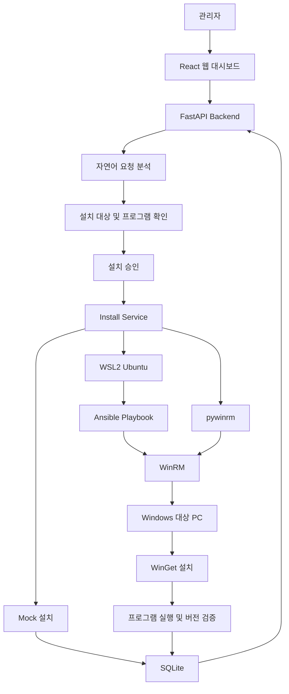

# InstallONE - 지재헌 프로토타입

## 1. 프로젝트 개요

InstallONE은 실습실 PC의 개발환경 설치 및 관리를
자동화하기 위한 서비스이다.

관리자가 웹 대시보드에서 자연어로 설치를 요청하면
설치 대상 PC와 프로그램을 분석하고,
관리자의 승인 이후 원격 설치를 진행한다.

설치 결과, 프로그램 버전, 검증 상태 및 실행 로그를
데이터베이스에 저장하고 웹에서 확인할 수 있도록 구현하였다.

## 2. 개발 목표

- 자연어 기반 개발환경 설치 요청
- 설치 대상 PC 및 프로그램 자동 분석
- 관리자 승인 기반 설치 실행
- Windows PC 원격 소프트웨어 설치
- 설치 여부 및 프로그램 버전 자동 검증
- 설치 작업 이력 및 실행 로그 관리
- 원격 연결 실패 및 예외 상황 처리

## 3. 기술 스택

| 구분 | 사용 기술 |
|---|---|
| Frontend | React, Vite, JavaScript, CSS |
| Backend | Python, FastAPI, Uvicorn |
| Database | SQLite |
| AI | HaiGPT 연동 예정, 현재 Mock 분석 |
| 원격 연결 | WinRM, pywinrm |
| 설치 자동화 | Ansible, WinGet |
| 가상화 | VMware Workstation Pro |
| Ansible 제어 노드 | WSL2 Ubuntu |
| 버전 관리 | Git, GitHub |
| 개발 도구 | VS Code |

## 4. 시스템 아키텍처



현재 자연어 요청 분석은 Mock 방식으로 동작하며,
실제 원격 설치는 pywinrm 또는 Ansible을 통해 수행한다.

## 5. 프로젝트 구조

```text
development/
├── README.md
├── .env.example
├── requirements.txt
├── backend/
│   ├── __init__.py
│   ├── main.py
│   ├── config.py
│   ├── ai_service.py
│   ├── database.py
│   ├── install_service.py
│   ├── remote_service.py
│   └── ansible_service.py
├── frontend/
│   ├── package.json
│   ├── index.html
│   └── src/
│       ├── App.jsx
│       ├── App.css
│       ├── index.css
│       └── api.js
└── ansible/
    ├── README.md
    ├── inventory.example.yml
    ├── requirements.txt
    ├── requirements.yml
    ├── run_playbook.py
    └── playbooks/
        ├── check_connection.yml
        ├── install_python.yml
        ├── install_java.yml
        ├── install_git.yml
        └── verify_programs.yml
```

## 6. 주요 기능

### 6.1 PC 관리

- PC-01부터 PC-08까지 기본 관리 대상 등록
- PC 이름, IP 주소, 운영체제, 상태 정보 관리
- 웹 대시보드에서 등록된 PC 목록 확인
- 실제 원격 설치 대상 유효성 검사

현재 실제 원격 설치 대상은 PC-01 한 대이다.
PC-02부터 PC-08까지는 논리적으로 등록된 관리 대상이다.

### 6.2 자연어 요청 분석

사용자가 입력한 자연어 요청에서
설치 대상 PC와 설치 프로그램을 추출한다.

요청 예시:

- 1번 PC에 Python 설치해 줘
- 1번 PC에 Python, Java, Git 설치해 줘
- 1번부터 4번 PC에 Python 설치해 줘
- 모든 PC에 Git 설치해 줘

현재 자연어 분석은 Mock 방식으로 구현되어 있다.

실제 설치 모드에서는 원격 연결 대상으로 설정되지 않은
PC에 대한 설치 요청을 차단한다.

### 6.3 설치 승인

자연어 분석 결과를 사용자에게 표시하고
설치 승인 이후에만 설치 작업을 실행한다.

승인되지 않은 설치 API 요청은 차단한다.

현재 승인 기능은 설치 실행 전 확인 절차이며,
관리자 계정 인증 및 권한 관리 기능은 구현되지 않았다.

### 6.4 설치 방식

| 설치 모드 | 설치 엔진 | 설명 |
|---|---|---|
| mock | 해당 없음 | 실제 설치 없이 결과 시뮬레이션 |
| real | pywinrm | WinRM 직접 연결 및 설치 |
| real | ansible | Ansible Playbook 기반 실제 설치 |

환경변수 설정을 통해 설치 방식을 선택할 수 있다.

Ansible 설치 실패 시 pywinrm으로 자동 전환하지 않는다.

### 6.5 지원 프로그램

| 프로그램 | 설치 패키지 | 테스트 버전 |
|---|---|---|
| Python | Python.Python.3.11 | 3.11.9 |
| Java | EclipseAdoptium.Temurin.21.JDK | 21.0.13.1 |
| Git | Git.Git | 2.56.1.windows.1 |

WinGet을 통해 프로그램을 설치한다.

이미 설치된 프로그램은 중복 설치하지 않으며,
설치 이후 실행 명령을 통해 프로그램 버전을 검증한다.

테스트 버전은 개발 당시 기준이며
패키지 업데이트에 따라 달라질 수 있다.

### 6.6 설치 결과 관리

다음 정보를 SQLite에 저장한다.

- 설치 요청 내용
- 설치 대상 PC
- 설치 프로그램
- 실행 모드
- 설치 작업 상태
- 설치된 프로그램 버전
- 설치 검증 상태
- 실행 로그
- 작업 생성 시간

웹 대시보드에서 설치 작업 이력과
PC별 상세 실행 결과를 확인할 수 있다.

## 7. 데이터베이스 구성

SQLite를 사용하며 백엔드 실행 시
installone.db 파일이 생성된다.

### pcs

PC 관리 대상 정보를 저장한다.

| 컬럼 | 설명 |
|---|---|
| id | PC 식별자 |
| name | PC 이름 |
| ip_address | PC IP 주소 |
| os | 운영체제 |
| status | PC 상태 |

### installation_jobs

설치 작업 정보를 저장한다.

| 컬럼 | 설명 |
|---|---|
| id | 설치 작업 식별자 |
| request | 자연어 설치 요청 |
| profile | 설치 프로그램 |
| status | 작업 상태 |
| mode | 실행 모드 |
| created_at | 작업 생성 시간 |

### installation_results

PC별 설치 실행 결과를 저장한다.

| 컬럼 | 설명 |
|---|---|
| id | 설치 결과 식별자 |
| job_id | 설치 작업 식별자 |
| pc_id | 대상 PC 식별자 |
| status | 설치 결과 상태 |
| installed_version | 설치 프로그램 버전 |
| verification | 설치 검증 상태 |
| log | 실행 로그 |

## 8. 실행 환경

### 개발 및 테스트 환경

| 항목 | 환경 |
|---|---|
| 초기 개발 환경 | macOS Apple Silicon |
| 원격 설치 개발 환경 | Windows 11 |
| 백엔드 Python | 3.11.9 |
| 대상 PC 운영체제 | Windows 11 Pro |
| 가상화 환경 | VMware Workstation Pro |
| Ansible 환경 | WSL2 Ubuntu 26.04.1 LTS |
| Ansible | 15.0.0 |
| Ansible Core | 2.22.0 |
| ansible.windows | 3.9.2 |
| 원격 연결 방식 | WinRM / NTLM |
| 실제 원격 설치 대상 | PC-01 |

### 필수 설치 프로그램

- Git
- Python 3.11
- Node.js 및 npm

실제 Ansible 원격 설치를 사용하는 경우 다음 환경이 추가로 필요하다.

- Windows 호스트
- WSL2 Ubuntu
- Ansible
- Windows 대상 PC 또는 가상머신
- WinRM
- WinGet

## 9. 프로젝트 실행 방법

### 9.1 저장소 복제

```bash
git clone -b prototype/jaeheon https://github.com/ssw12099/openSW_InstallONE_1team.git
cd openSW_InstallONE_1team/development
```

### 9.2 백엔드 가상환경 생성

Windows PowerShell:

```powershell
py -3.11 -m venv .venv
.\.venv\Scripts\Activate.ps1
```

macOS:

```bash
python3.11 -m venv .venv
source .venv/bin/activate
```

### 9.3 백엔드 의존성 설치

```bash
python -m pip install -r requirements.txt
```

### 9.4 환경변수 설정

Windows PowerShell:

```powershell
Copy-Item .env.example .env
```

macOS:

```bash
cp .env.example .env
```

처음 실행하는 경우 Mock 모드를 권장한다.

```dotenv
AI_MODE=mock
INSTALL_MODE=mock
INSTALL_ENGINE=pywinrm
```

Mock 모드에서는 실제 Windows 대상 PC 없이
웹 대시보드와 설치 시뮬레이션 기능을 확인할 수 있다.

### 9.5 백엔드 실행

development 디렉터리에서 실행한다.

```bash
python -m uvicorn backend.main:app --reload --port 8000
```

백엔드 주소:

http://localhost:8000

Swagger API 문서:

http://localhost:8000/docs

### 9.6 프론트엔드 실행

새로운 터미널에서 development/frontend 디렉터리로 이동한다.

```bash
npm install
npm run dev
```

웹 대시보드 주소:

http://localhost:5173

백엔드와 프론트엔드 서버를 동시에 실행해야 한다.

## 10. 실제 원격 설치 설정

### 10.1 대상 Windows PC 준비

- 관리자 권한을 가진 사용자 계정 설정
- 실제 계정 비밀번호 설정
- WinRM 서비스 활성화
- WinGet 사용 가능 여부 확인
- 호스트와 대상 PC 간 네트워크 연결 확인
- WinRM 방화벽 접근 범위 설정

### 10.2 환경변수 설정

development/.env 파일을 수정한다.

```dotenv
AI_MODE=mock

INSTALL_MODE=real
INSTALL_ENGINE=ansible

WINRM_HOST=
WINRM_PORT=5985
WINRM_USERNAME=
WINRM_PASSWORD=
WINRM_TRANSPORT=ntlm

ANSIBLE_WSL_DISTRO=Ubuntu
ANSIBLE_PYTHON_PATH=
```

실제 IP 주소와 계정 정보는 각 개발 환경에 맞게 입력한다.

Ansible 환경 구축 및 세부 실행 방법은
[Ansible README](ansible/README.md)를 참고한다.

pywinrm 방식으로 실행하려면 다음과 같이 변경한다.

```dotenv
INSTALL_ENGINE=pywinrm
```

### 10.3 실제 대상 PC 등록

development 디렉터리에서 백엔드 가상환경을 활성화한 후 실행한다.

```bash
python -c "from backend.database import init_db, update_pc_info; from backend.config import WINRM_HOST; from backend.remote_service import check_connection; init_db(); result = check_connection(); update_pc_info(1, WINRM_HOST, 'Windows 11 Pro', 'online' if result['connected'] else 'offline'); print(result)"
```

PC-01의 IP 주소가 WINRM_HOST와 일치해야
실제 원격 설치 요청이 가능하다.

현재 PC 상태는 위 등록 과정에서 저장된 값이며,
실시간으로 자동 갱신되는 상태 정보는 아니다.

환경변수를 수정한 경우 백엔드 서버를 재시작한다.

## 11. 주요 API

| Method | Endpoint | 설명 |
|---|---|---|
| GET | / | 백엔드 기본 응답 |
| GET | /api/pcs | 등록된 PC 목록 조회 |
| GET | /api/config | 실행 환경 설정 조회 |
| GET | /api/profiles | 지원 설치 프로그램 조회 |
| POST | /api/install | 설치 작업 실행 |
| GET | /api/jobs | 설치 작업 이력 조회 |

전체 API 목록과 요청 형식은 Swagger에서 확인할 수 있다.

### 설치 API 요청 예시

```json
{
  "request": "PC-01에 Python, Java, Git 설치해줘",
  "pc_ids": [1],
  "profiles": [
    "python",
    "java",
    "git"
  ],
  "approved": true
}
```

실제 설치 모드에서는 승인된 요청만 실행된다.

## 12. 설치 상태 정의

| 상태 | 설명 |
|---|---|
| pending | 작업 대기 |
| running | 작업 실행 중 |
| simulated | 모의 설치 완료 |
| success | 설치 작업 성공 |
| already_installed | 기존 설치 확인 |
| failed | 설치 또는 연결 실패 |
| partial_success | 일부 설치 작업 성공 |
| verified | 실행 및 버전 검증 완료 |
| not_verified | 검증 실패 또는 미수행 |

설치 작업 전체의 상태와 PC별 설치 결과 상태는
서로 구분하여 관리한다.

## 13. 실제 구현 및 테스트 결과

테스트 기간: 2026-11-26 ~ 2026-11-27

### 기본 기능

| 테스트 항목 | 결과 |
|---|---|
| FastAPI 백엔드 실행 | 성공 |
| React 프론트엔드 실행 | 성공 |
| PC 목록 조회 | 성공 |
| Mock 자연어 요청 분석 | 성공 |
| 설치 승인 검사 | 성공 |
| Mock 설치 시뮬레이션 | 성공 |
| SQLite 설치 결과 저장 | 성공 |
| 설치 작업 이력 조회 | 성공 |

### 실제 원격 설치

| 테스트 항목 | 결과 |
|---|---|
| VMware Windows 11 VM 구축 | 성공 |
| WinRM 원격 연결 | 성공 |
| pywinrm Python 신규 설치 | 성공 |
| pywinrm Java 신규 설치 | 성공 |
| pywinrm Git 신규 설치 | 성공 |
| 웹 기반 pywinrm Git 신규 설치 | 성공 |
| WSL2 Ansible 환경 구축 | 성공 |
| Ansible WinRM 연결 | 성공 |
| Ansible Python 기존 설치 검증 | 성공 |
| Ansible Java 및 javac 검증 | 성공 |
| Ansible Git 기존 설치 검증 | 성공 |
| Ansible Git 신규 설치 | 성공 |
| FastAPI와 Ansible 연동 | 성공 |
| 웹 대시보드와 Ansible 연동 | 성공 |
| 웹 기반 Ansible Git 신규 설치 | 성공 |

### 예외 처리

| 테스트 항목 | 결과 |
|---|---|
| 미등록 원격 설치 대상 차단 | 성공 |
| 기존 설치 프로그램 중복 설치 방지 | 성공 |
| VM 연결 중단 시 실패 처리 | 성공 |
| 연결 실패 로그 저장 | 성공 |
| VM 연결 복구 후 재요청 | 성공 |

## 14. 주요 실제 테스트 사례

### 작업 #21: 웹 기반 Ansible Git 신규 설치

대상 VM에 설치되어 있던 Git을 삭제한 후
웹 대시보드에서 Git 설치를 요청하였다.

Ansible 실행 결과:

```text
ok=4
changed=1
unreachable=0
failed=0
skipped=0
```

설치 이후 VM 내부에서 다음 항목을 확인하였다.

- WinGet 설치 목록에 Git 등록
- git --version 정상 실행
- Git 실행 파일 존재 여부 확인

설치 버전: 2.56.1.windows.1

### 작업 #22: VM 연결 중단

VM을 일시 중지한 상태에서 설치를 요청하였다.

```text
unreachable=1
changed=0
```

백엔드에서 실패 상태와 오류 로그를 정상적으로 저장하였다.

### 작업 #23: VM 연결 복구

VM을 다시 실행한 후 Git 설치를 요청하였다.

```text
ok=3
changed=0
unreachable=0
failed=0
skipped=1
```

기존 설치 상태 및 버전 검증이 정상적으로 수행되었다.

## 15. 구현 현황

### 구현 완료

- React 웹 대시보드
- FastAPI 백엔드
- SQLite 데이터베이스
- PC 관리 대상 목록
- Mock 자연어 요청 분석
- 설치 승인 절차
- Mock 설치 시뮬레이션
- pywinrm 실제 원격 설치
- Ansible 실제 원격 설치
- Python, Java, Git 설치 프로필
- 설치 버전 검증
- 중복 설치 방지
- 설치 결과 및 로그 저장
- 미등록 원격 설치 대상 차단
- 연결 장애 및 예외 처리

### 미구현 및 개선 예정

- HaiGPT 실제 API 연동
- 다중 PC 실제 원격 설치
- 실시간 PC 연결 상태 갱신
- 관리자 로그인 및 권한 관리
- 설치 진행률 실시간 표시
- 자동 재시도
- 설치 프로그램 확장
- Ansible 구조화된 실행 결과 처리
- 설치 로그 가독성 개선
- 설치 상태 한글 표시
- 한국 시간 기준 작업 이력 표시
- Python 및 Java Ansible 신규 설치 추가 검증
- 다른 개발 환경에서의 실행 재현성 검증

## 16. 보안 및 Git 관리

다음 파일 및 정보는 저장소에 업로드하지 않는다.

- 실제 .env 파일
- API Key
- 실제 원격 접속 정보
- 사용자 계정 비밀번호
- SQLite 실제 데이터베이스
- Python 가상환경
- node_modules
- Windows 가상머신 이미지
- 운영체제 ISO 및 설치 파일

WinRM 연결에는 NTLM 인증 및 메시지 암호화를 사용한다.

실습용 네트워크에서 필요한 제어 노드의 접근만 허용하도록
방화벽을 구성한다.

현재 프로젝트는 실습용 프로토타입이며,
실제 운영 환경에서는 추가적인 보안 및 인증 구성이 필요하다.

## 17. 개발 브랜치 및 개발일지

개발 브랜치:

prototype/jaeheon

개인 개발일지:

- [2026-11-26 개발일지](../docs/devlogs/지재헌/2026-11-26.md)
- [2026-11-27 개발일지](../docs/devlogs/지재헌/2026-11-27.md)

프로토타입 비교 및 팀 회의 이후
최종 개발 방향을 결정할 예정이다.