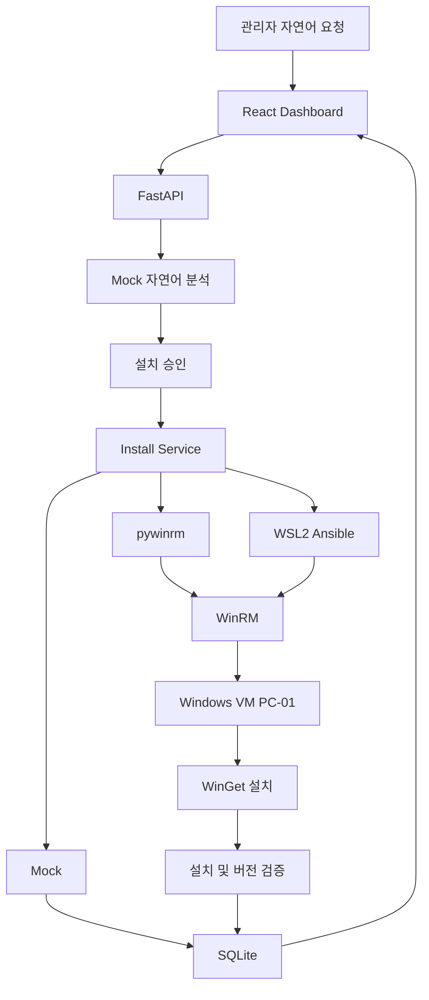

# 2026-11-27 개발일지

## 1. 개발 정보

- 작성자: 지재헌
- 개발 브랜치: prototype/jaeheon
- 프로젝트: InstallONE
- 개발 주제: 실제 Windows PC 원격 설치 및 Ansible 연동

## 2. 오늘의 개발 목표

- Windows 가상머신 기반 실제 원격 설치 환경 구축
- WinRM을 통한 원격 명령 실행
- Python, Java, Git 실제 설치 및 검증
- WSL2 기반 Ansible 실행 환경 구축
- 기존 FastAPI 백엔드와 Ansible 연동
- 웹 대시보드 기반 실제 원격 설치
- 원격 연결 실패 및 예외 처리 검증
- 프로젝트 실행 문서 작성

## 3. 개발 환경

| 항목 | 환경 |
|---|---|
| 호스트 OS | Windows 11 |
| CPU | Intel Core i5-14500 |
| RAM | 32GB |
| 개발 도구 | VS Code |
| 백엔드 Python | 3.11.9 |
| 가상화 프로그램 | VMware Workstation Pro |
| 대상 VM OS | Windows 11 Pro |
| 대상 VM 메모리 | 8GB |
| 대상 VM 논리 프로세서 | 4개 |
| 대상 VM 저장 공간 | 80GB |
| 네트워크 | VMware NAT |
| Ansible 제어 노드 | WSL2 Ubuntu 26.04.1 LTS |
| WSL Python | 3.14.4 |
| Ansible | 15.0.0 |
| Ansible Core | 2.22.0 |
| ansible.windows | 3.9.2 |
| pywinrm | 0.5.0 |
| 패키지 관리자 | WinGet |
| 데이터베이스 | SQLite |

## 4. 작업 내용

### 4.1 Windows 개발 환경 이전

기존 macOS에서 개발하던 프로토타입을
Windows 데스크톱 환경으로 이전하였다.

- GitHub 개인 개발 브랜치 복제
- Python 3.11 가상환경 구축
- 백엔드 의존성 설치
- FastAPI 서버 실행 확인
- React 프론트엔드 실행 확인
- 기존 Mock 설치 기능 확인

### 4.2 Windows 가상머신 구축

실제 원격 설치를 테스트하기 위해
VMware Workstation Pro를 사용하였다.

- Windows 11 Pro 가상머신 구축
- VMware Tools 설치
- 가상머신 호스트명 설정
- VMware NAT 네트워크 구성
- Windows 보안 업데이트 적용
- 호스트와 가상머신 간 네트워크 연결 확인

실제 설치 대상은 PC-01 한 대로 구성하였다.

PC-02부터 PC-08까지는 데이터베이스에 등록된
논리적인 관리 대상이며 실제 원격 연결은 구성하지 않았다.

### 4.3 WinRM 원격 연결 구축

Windows 가상머신에 WinRM 서비스를 활성화하고
호스트에서 원격 명령을 실행할 수 있도록 구성하였다.

- 네트워크 프로필 설정
- WinRM 서비스 활성화
- WinRM 자동 시작 설정
- TCP 5985 포트 연결 확인
- 방화벽 접근 범위 제한
- NTLM 인증 적용
- WinRM 메시지 암호화 적용

pywinrm을 사용하여 다음 원격 명령을 테스트하였다.

- hostname
- whoami
- Windows 운영체제 정보 조회
- WinGet 버전 확인

모든 기본 원격 연결 테스트에 성공하였다.

### 4.4 pywinrm 기반 실제 프로그램 설치

WinRM을 통해 Windows 가상머신에
Python, Java, Git을 실제로 설치하였다.

| 프로그램 | 설치 버전 | 결과 |
|---|---|---|
| Python | 3.11.9 | 성공 |
| Java JDK | 21.0.13.1 | 성공 |
| Git | 2.56.1.windows.1 | 성공 |

WinGet을 사용하여 설치를 수행하였으며
설치 이후 실제 실행 명령으로 버전을 확인하였다.

Python은 간단한 연산 코드 실행을 통해
정상적으로 동작하는 것도 확인하였다.

### 4.5 원격 설치 백엔드 구현

backend/remote_service.py를 추가하였다.

주요 구현 기능:

- WinRM 세션 생성
- 원격 명령 실행
- 원격 연결 상태 확인
- 프로그램별 설치 패키지 정의
- 기존 설치 여부 확인
- WinGet 기반 실제 설치
- 설치 이후 프로그램 버전 검증
- 중복 설치 방지
- 설치 실패 처리

기존 Mock 설치 기능은 유지하면서
실제 설치 모드를 추가하였다.

### 4.6 데이터베이스 및 설치 서비스 수정

backend/database.py에 PC 정보 조회 및
갱신 기능을 추가하였다.

backend/install_service.py를 수정하여
실제 원격 설치 결과를 저장하도록 구현하였다.

저장 항목:

- 설치 작업 상태
- 설치 대상 PC
- 설치 프로그램
- 설치된 버전
- 검증 상태
- 원격 실행 로그

실제 원격 설치 대상으로 설정되지 않은 PC의
설치 요청을 차단하도록 구현하였다.

### 4.7 pywinrm 웹 대시보드 연동

웹 대시보드에서 자연어 요청을 입력하고
설치 승인 이후 실제 설치가 실행되도록 연동하였다.

Git을 가상머신에서 삭제한 뒤
웹 대시보드를 통해 다시 설치하였다.

설치 결과와 버전이 데이터베이스에 저장되고
웹 대시보드에서 정상적으로 표시되는 것을 확인하였다.

### 4.8 WSL2 및 Ansible 환경 구축

Windows에서 Ansible 제어 노드를 실행하기 위해
WSL2 Ubuntu 환경을 구축하였다.

- WSL2 설치
- Ubuntu 초기 환경 설정
- Python 가상환경 생성
- Ansible 설치
- pywinrm 설치
- python-dotenv 설치
- ansible.windows Collection 확인

WSL에서 Windows 가상머신으로
네트워크 및 WinRM 연결을 확인하였다.

Ansible win_ping 실행 결과:

```text
SUCCESS
ping: pong
```

### 4.9 Ansible Playbook 구현

development/ansible 디렉터리를 구성하였다.

| 파일 | 역할 |
|---|---|
| inventory.example.yml | 원격 설치 대상 및 인증 설정 |
| run_playbook.py | Playbook 실행 및 환경변수 전달 |
| check_connection.yml | 원격 연결 확인 |
| install_python.yml | Python 설치 및 검증 |
| install_java.yml | Java 설치 및 검증 |
| install_git.yml | Git 설치 및 검증 |
| verify_programs.yml | 프로그램 통합 검증 |

각 설치 Playbook에서 기존 설치 여부를 확인하고
필요한 경우에만 설치하도록 구현하였다.

Java는 java 및 javac 실행 여부를 모두 확인하였다.

Git을 삭제한 후 Ansible Playbook을 실행하여
실제 신규 설치가 정상적으로 수행되는 것을 확인하였다.

### 4.10 FastAPI와 Ansible 연동

backend/ansible_service.py를 추가하였다.

Windows 백엔드에서 WSL Ubuntu의
Ansible 실행 스크립트를 호출하도록 구현하였다.

주요 구현 기능:

- Windows 경로의 WSL 경로 변환
- WSL Python 실행
- Ansible Playbook 호출
- 실행 결과 및 오류 로그 수집
- 실행 시간 초과 처리
- 설치 프로그램 버전 추출
- 신규 설치와 기존 설치 구분
- 기존 데이터베이스 결과 형식으로 변환

환경변수 INSTALL_ENGINE을 추가하여
설치 엔진을 선택할 수 있도록 구성하였다.

| 설치 모드 | 설치 엔진 | 동작 |
|---|---|---|
| mock | 무관 | 모의 설치 |
| real | pywinrm | WinRM 직접 설치 |
| real | ansible | Ansible 기반 실제 설치 |

기존 pywinrm 설치 방식도 유지하였다.

### 4.11 Swagger API 테스트

FastAPI Swagger에서 Python, Java, Git 설치 요청을
실행하여 Ansible 연동 결과를 확인하였다.

Python과 Git은 정상적으로 처리되었으나
Java 버전 추출 과정에서 오류가 발생하였다.

오류 수정 이후 Java 설치 상태와 버전도
정상적으로 반환되는 것을 확인하였다.

### 4.12 웹 대시보드 Ansible 연동

웹 대시보드에서 다음 요청을 실행하였다.

```text
1번 PC에 Python, Java, Git 설치해 줘
```

세 프로그램 모두 기존 설치 여부와 버전 검증에 성공하였다.

| 작업 ID | 프로그램 | 설치 버전 | 결과 |
|---|---|---|---|
| 18 | Python | 3.11.9 | already_installed |
| 19 | Java | 21.0.13.1 | already_installed |
| 20 | Git | 2.56.1.windows.1 | already_installed |

모든 작업에서 Ansible 실행 로그가
정상적으로 저장되고 표시되었다.

### 4.13 웹 기반 Ansible 실제 신규 설치

대상 가상머신에서 Git을 삭제한 뒤
웹 대시보드에서 다시 설치를 요청하였다.

설치 전 확인 결과:

- WinGet 설치 목록에서 Git 확인 불가
- git --version 실행 불가
- Git 실행 파일 존재 여부 False

웹 대시보드 설치 작업 결과:

```text
작업 ID: 21
설치 모드: real
설치 엔진: ansible
설치 상태: success
설치 버전: 2.56.1.windows.1
검증 상태: verified
```

Ansible 실행 결과:

```text
ok=4
changed=1
unreachable=0
failed=0
skipped=0
```

설치 완료 후 가상머신 내부에서 확인하였다.

- WinGet 설치 목록에 Git 등록
- git --version 정상 실행
- Git 실행 파일 존재 여부 True

웹 요청부터 실제 원격 설치, 버전 검증,
데이터베이스 저장 및 결과 표시까지 성공하였다.

### 4.14 예외 처리 테스트

#### 미등록 원격 설치 대상 요청

PC-02에 Git 설치를 요청하였다.

실제 원격 설치 대상으로 등록되지 않았다는
오류 메시지가 정상적으로 표시되었다.

#### VM 연결 중단 테스트

가상머신을 일시 중지한 상태에서
PC-01에 Git 설치를 요청하였다.

작업 ID: 22

```text
설치 상태: failed
설치 버전: 미확인
검증 상태: not_verified
unreachable=1
```

연결 실패가 정상적으로 처리되었으며
오류 로그가 웹 대시보드에 표시되었다.

#### VM 연결 복구 테스트

가상머신을 다시 실행한 후
Git 설치를 재요청하였다.

작업 ID: 23

```text
설치 상태: already_installed
설치 버전: 2.56.1.windows.1
검증 상태: verified
unreachable=0
failed=0
```

연결 복구 이후 정상적으로 설치 작업을
수행할 수 있는 것을 확인하였다.

### 4.15 의존성 및 문서 정리

Windows 백엔드와 WSL Ansible의
의존성 파일을 분리하였다.

- development/requirements.txt 수정
- development/ansible/requirements.txt 추가
- development/ansible/requirements.yml 추가
- development/ansible/README.md 작성
- development/README.md 작성

실행 환경 구축 방법, 실제 테스트 결과,
현재 구현 범위 및 미구현 기능을 정리하였다.

## 5. 개발 중 발생한 문제 및 해결

### 5.1 가상머신 네트워크 연결 실패

초기 호스트와 가상머신 간 Ping 연결이
정상적으로 이루어지지 않았다.

Windows 방화벽에 실습용 네트워크 범위의
ICMP 접근을 허용하여 해결하였다.

### 5.2 WinRM 인증 오류

원격 명령 실행 과정에서 HTTP 401
인증 오류가 발생하였다.

대상 Windows 계정의 실제 비밀번호를 설정하고
계정 및 인증 정보를 확인하여 해결하였다.

### 5.3 WinRM 서비스 중지

가상머신 재시작 이후 WinRM 서비스가
중지된 상태로 확인되었다.

WinRM 서비스의 시작 유형을 자동으로 변경하고
서비스를 다시 시작하였다.

### 5.4 Python 원격 명령 인자 처리 오류

원격 Python 코드 실행 과정에서
명령어 인자 처리 문제로 SyntaxError가 발생하였다.

테스트 코드의 전달 형식을 수정하여
정상적인 Python 실행을 확인하였다.

### 5.5 Windows와 WSL 경로 변환 오류

Windows 경로의 역슬래시가 WSL 명령 실행 과정에서
정상적으로 처리되지 않는 문제가 발생하였다.

Path.as_posix()를 사용하여 경로를 변환하고
wslpath를 통해 WSL 경로를 생성하도록 수정하였다.

### 5.6 Java 버전 추출 오류

Ansible 실행 결과에 포함된 이스케이프 문자로 인해
Java 버전 추출에 실패하였다.

출력 문자열을 정규화한 후 정규표현식을
적용하도록 수정하여 해결하였다.

### 5.7 설치 직후 환경변수 갱신 문제

프로그램 설치 직후 기존 PowerShell에서
새로 설치한 명령어가 인식되지 않는 경우가 있었다.

PowerShell을 다시 실행하거나
실제 프로그램 실행 파일 경로를 사용하여 확인하였다.

## 6. 최종 테스트 결과

| 테스트 항목 | 결과 |
|---|---|
| Windows VM 구축 | 성공 |
| WinRM 원격 연결 | 성공 |
| pywinrm Python 실제 설치 | 성공 |
| pywinrm Java 실제 설치 | 성공 |
| pywinrm Git 실제 설치 | 성공 |
| 웹 기반 pywinrm Git 신규 설치 | 성공 |
| WSL2 Ansible 환경 구축 | 성공 |
| Ansible 원격 연결 | 성공 |
| Ansible Python 기존 설치 검증 | 성공 |
| Ansible Java 및 javac 검증 | 성공 |
| Ansible Git 기존 설치 검증 | 성공 |
| Ansible Git 실제 신규 설치 | 성공 |
| FastAPI Ansible 연동 | 성공 |
| 웹 대시보드 Ansible 연동 | 성공 |
| 웹 기반 Ansible Git 신규 설치 | 성공 |
| SQLite 설치 결과 저장 | 성공 |
| 중복 설치 방지 | 성공 |
| 미등록 원격 설치 대상 차단 | 성공 |
| VM 연결 중단 시 실패 처리 | 성공 |
| VM 연결 복구 후 재요청 | 성공 |

## 7. 현재 시스템 구성



## 8. 현재 구현 범위 및 한계

### 구현 완료

- 웹 대시보드 기반 설치 요청
- Mock 자연어 요청 분석
- 설치 승인 절차
- 실제 Windows 원격 설치
- pywinrm 및 Ansible 설치 엔진 선택
- 프로그램 설치 여부 및 버전 검증
- 설치 결과 및 실행 로그 저장
- 중복 설치 방지
- 미등록 원격 설치 대상 차단
- 연결 실패 및 복구 처리

### 미구현 및 추가 검증 필요

- HaiGPT 실제 API 연동
- 다중 PC 실제 원격 설치
- 관리자 로그인 및 권한 관리
- 실시간 PC 연결 상태 갱신
- 실시간 설치 진행률 표시
- 자동 재시도
- Python 및 Java의 Ansible 신규 설치 검증
- Ansible 구조화된 결과 처리
- 설치 로그 가독성 개선
- 설치 상태 한글 표시
- 한국 시간 기준 작업 이력 표시
- 다른 개발 환경에서의 실행 재현성 검증

현재 실제 원격 설치 대상은 PC-01 한 대이며
자연어 분석은 Mock 방식으로 동작한다.

## 9. 보안 및 Git 관리

- 실제 API Key 및 접속 정보는 .env에서 관리
- 실제 계정 비밀번호는 저장소에 포함하지 않음
- WinRM NTLM 인증 및 메시지 암호화 적용
- 실습용 네트워크의 방화벽 접근 범위 제한
- 실제 SQLite 데이터베이스 업로드 제외
- 가상머신 이미지 및 운영체제 설치 파일 업로드 제외
- 개인 프로토타입 브랜치에서 개발 진행

## 10. 다음 개발 계획

1. 현재 구현 파일 및 민감정보 검사
2. 개인 프로토타입 브랜치 커밋 및 Push
3. Draft PR 개발 진행 상황 업데이트
4. HaiGPT 실제 API 연동
5. 웹 대시보드 UI 개선
6. Python 및 Java Ansible 신규 설치 추가 검증
7. 다중 PC 지원 방향 검토
8. 프로토타입 비교 및 팀 회의 준비

## 11. 개발 소감

기존에는 설치 요청을 분석하고 결과를
시뮬레이션하는 기능까지만 구현되어 있었다.

오늘은 Windows 가상머신과 WinRM을 구성하고
실제 프로그램을 원격으로 설치하는 기능을 구현하였다.

이후 WSL2와 Ansible을 추가하여
웹 대시보드에서 요청한 설치 작업이
실제 가상머신에서 실행되도록 연동하였다.

개발 과정에서 원격 인증, 네트워크 연결,
Windows와 WSL 간 경로 변환 등의 문제가 발생했지만
각 단계별로 테스트하면서 해결하였다.

특히 가상머신에서 Git을 삭제한 뒤
웹 대시보드를 통해 다시 설치하고,
실제 실행까지 확인한 점이 오늘의 주요 성과이다.

아직 실제 AI 연동과 다중 PC 관리 기능은
구현되지 않았으므로 다음 개발 과정에서
추가로 진행할 예정이다.